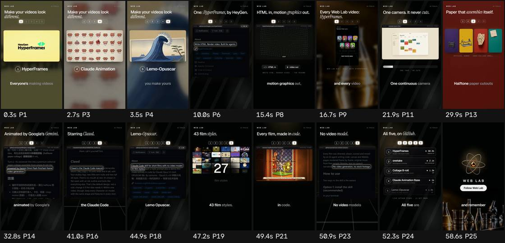

# Ficha de referencia · 1

Archivo `referencias/1.mp4` · 58,9 s · 720×1280 vertical (9:16) · 30,00 fps · audio 2 canal(es)

Generada el 2026-10-25 · transcripción small, idioma `en` · cortes con umbral 27.0.

## Ritmo en una mirada

- **Planos:** 25, uno cada 2,4 s de media (mediana 2,3 s, de 0,5 a 5,5 s) · 24,4 cortes por minuto.
- **Habla:** 114 palabras · 2,66 palabras/s mientras habla (1,93 sobre el total) · habla el 73% del video · primera palabra a los 0,00 s.
- **Bloques** (frases separadas por pausas de 0,30 s o fin de oración): 29, 3,0 palabras y 1,2 s de mediana (de 0,3 a 4,8 s).
- **Pausas** de 0,25 s o más: 25, mediana 0,58 s, la más larga 0,98 s.

## Planos

| # | inicio | fin | dura | qué se dice |
| --- | --- | --- | --- | --- |
| 1 | 0,00 | 1,53 | 1,53 | Everyone's making videos with |
| 2 | 1,53 | 2,27 | 0,73 | Claude now, |
| 3 | 2,27 | 3,13 | 0,87 | so |
| 4 | 3,13 | 3,97 | 0,83 | how do you make |
| 5 | 3,97 | 9,43 | 5,47 | yours look different? Five Claude skills. Five completely different styles. |
| 6 | 9,43 | 13,03 | 3,60 | One Hyperframes by Hagen. |
| 7 | 13,03 | 14,83 | 1,80 | HTML in, motion |
| 8 | 14,83 | 16,07 | 1,23 | graphics out, |
| 9 | 16,07 | 19,00 | 2,93 | and every video on this channel is built with it. |
| 10 | 19,00 | 21,30 | 2,30 | Two. One take. One |
| 11 | 21,30 | 24,70 | 3,40 | continuous camera that never cuts. Free |
| 12 | 24,70 | 29,33 | 4,63 | for non -commercial use. Three. Collage b -roll. |
| 13 | 29,33 | 32,23 | 2,90 | Half -tone paper cutouts that assemble themselves. |
| 14 | 32,23 | 37,67 | 5,43 | Animated by Google's Gemini. Four. Claude animation base. |
| 15 | 37,67 | 40,43 | 2,77 | Hand -painted cartoons starring Claude. |
| 16 | 40,43 | 41,90 | 1,47 | The Claude Code mascot. |
| 17 | 41,90 | 44,27 | 2,37 | Five. The wildest. |
| 18 | 44,27 | 46,57 | 2,30 | Lemmo Opuskar. Forty |
| 19 | 46,57 | 48,37 | 1,80 | -three film styles. |
| 20 | 48,37 | 48,87 | 0,50 | Every film |
| 21 | 48,87 | 49,83 | 0,97 | made in code. |
| 22 | 49,83 | 50,33 | 0,50 |  |
| 23 | 50,33 | 51,67 | 1,33 | No video model. |
| 24 | 51,67 | 56,10 | 4,43 | All five are on GitHub. Pick one and make it yours. Follow |
| 25 | 56,10 | 58,83 | 2,73 | WebLab. And remember... |

## Bloques de habla

| # | inicio | dura | palabras | pal/s | texto |
| --- | --- | --- | --- | --- | --- |
| 1 | 0,00 | 4,84 | 14 | 2,9 | Everyone's making videos with Claude now, so how do you make yours look different? |
| 2 | 5,32 | 1,10 | 3 | 2,7 | Five Claude skills. |
| 3 | 7,06 | 1,96 | 4 | 2,0 | Five completely different styles. |
| 4 | 9,50 | 2,50 | 4 | 1,6 | One Hyperframes by Hagen. |
| 5 | 12,76 | 1,22 | 2 | 1,6 | HTML in, |
| 6 | 14,54 | 1,06 | 3 | 2,8 | motion graphics out, |
| 7 | 16,22 | 2,58 | 10 | 3,9 | and every video on this channel is built with it. |
| 8 | 19,02 | 0,26 | 1 | 3,8 | Two. |
| 9 | 20,10 | 0,40 | 2 | 5,0 | One take. |
| 10 | 21,10 | 2,60 | 6 | 2,3 | One continuous camera that never cuts. |
| 11 | 24,24 | 1,94 | 5 | 2,6 | Free for non -commercial use. |
| 12 | 26,18 | 0,66 | 1 | 1,5 | Three. |
| 13 | 27,72 | 1,02 | 3 | 2,9 | Collage b -roll. |
| 14 | 29,28 | 2,34 | 7 | 3,0 | Half -tone paper cutouts that assemble themselves. |
| 15 | 32,18 | 1,64 | 4 | 2,4 | Animated by Google's Gemini. |
| 16 | 34,32 | 0,28 | 1 | 3,6 | Four. |
| 17 | 35,58 | 1,12 | 3 | 2,7 | Claude animation base. |
| 18 | 37,62 | 2,38 | 5 | 2,1 | Hand -painted cartoons starring Claude. |
| 19 | 40,34 | 1,18 | 4 | 3,4 | The Claude Code mascot. |
| 20 | 42,02 | 0,30 | 1 | 3,3 | Five. |
| 21 | 42,86 | 0,74 | 2 | 2,7 | The wildest. |
| 22 | 44,20 | 1,12 | 2 | 1,8 | Lemmo Opuskar. |
| 23 | 46,10 | 1,60 | 4 | 2,5 | Forty -three film styles. |
| 24 | 48,28 | 1,52 | 5 | 3,3 | Every film made in code. |
| 25 | 50,44 | 0,92 | 3 | 3,3 | No video model. |
| 26 | 51,70 | 1,16 | 5 | 4,3 | All five are on GitHub. |
| 27 | 53,76 | 1,70 | 6 | 3,5 | Pick one and make it yours. |
| 28 | 55,70 | 1,36 | 2 | 1,5 | Follow WebLab. |
| 29 | 57,46 | 1,30 | 2 | 1,5 | And remember... |

## Tira de momentos clave

- 0,3 s · arranque · plano 1 · "Everyone's making"
- 2,7 s · entra el plano · plano 3 · "now, so how"
- 3,5 s · entra el plano · plano 4 · "so how do you make yours"
- 10,0 s · entra el plano · plano 6 · "One Hyperframes"
- 15,4 s · entra el plano · plano 8 · "graphics out,"
- 16,7 s · entra el plano · plano 9 · "and every video on this"
- 21,9 s · entra el plano · plano 11 · "One continuous camera"
- 29,9 s · entra el plano · plano 13 · "Half -tone paper cutouts"
- 32,8 s · entra el plano · plano 14 · "Animated by Google's"
- 41,0 s · entra el plano · plano 16 · "The Claude Code mascot."
- 44,9 s · entra el plano · plano 18 · "Lemmo Opuskar."
- 47,2 s · entra el plano · plano 19 · "Forty -three film styles."
- 49,4 s · entra el plano · plano 21 · "film made in code."
- 50,9 s · entra el plano · plano 23 · "No video model."
- 52,3 s · entra el plano · plano 24 · "All five are on GitHub."
- 58,6 s · final · plano 25 · "And remember..."

## Cómo usarla

- Los números son de la referencia: sirven de molde para el ritmo de cortes y de habla.
- Los bloques salen del habla, no de los subtítulos quemados en el video (no se leen). Para ver cómo están puestos los subtítulos, mirá la tira.
- Movimientos de cámara y estilo de subtítulos no se copian solos: se proponen en el plan que aprueba Juani.
