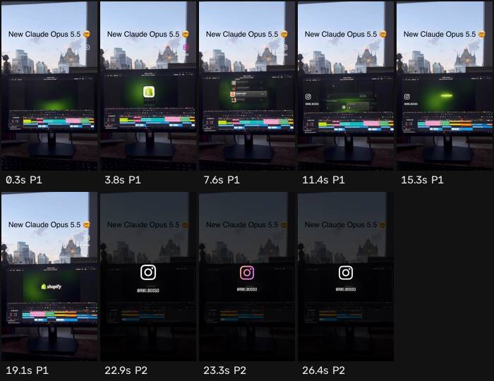

# Ficha de referencia · 10

Archivo `referencias/10.mp4` · 26,7 s · 576×1024 vertical (9:16) · 30,00 fps · audio 2 canal(es)

Generada el 2026-10-25 · transcripción small, idioma `en` · cortes con umbral 27.0.

## Ritmo en una mirada

- **Planos:** 2, uno cada 13,3 s de media (mediana 13,3 s, de 4,0 a 22,7 s) · 2,2 cortes por minuto.
- **Habla:** 28 palabras · 3,31 palabras/s mientras habla (1,05 sobre el total) · habla el 32% del video · primera palabra a los 0,00 s.
- **Bloques** (frases separadas por pausas de 0,30 s o fin de oración): 11, 2,0 palabras y 0,6 s de mediana (de 0,3 a 2,1 s).
- **Pausas** de 0,25 s o más: 10, mediana 0,64 s, la más larga 2,60 s.

## Planos

| # | inicio | fin | dura | qué se dice |
| --- | --- | --- | --- | --- |
| 1 | 0,00 | 22,70 | 22,70 | It starts with something you made. Tap once, you're open. T -shirts, shoes, jackets. Somewhere, someone found you. Sell what you make. And hear your first sale. Shopify. |
| 2 | 22,70 | 26,70 | 4,00 |  |

## Bloques de habla

| # | inicio | dura | palabras | pal/s | texto |
| --- | --- | --- | --- | --- | --- |
| 1 | 0,00 | 2,06 | 6 | 2,9 | It starts with something you made. |
| 2 | 2,68 | 0,88 | 2 | 2,3 | Tap once, |
| 3 | 3,88 | 0,54 | 2 | 3,7 | you're open. |
| 4 | 4,94 | 0,48 | 2 | 4,2 | T -shirts, |
| 5 | 6,02 | 0,40 | 1 | 2,5 | shoes, |
| 6 | 7,08 | 0,34 | 1 | 2,9 | jackets. |
| 7 | 9,00 | 0,60 | 1 | 1,7 | Somewhere, |
| 8 | 10,02 | 0,74 | 3 | 4,1 | someone found you. |
| 9 | 11,58 | 0,78 | 4 | 5,1 | Sell what you make. |
| 10 | 13,18 | 1,26 | 5 | 4,0 | And hear your first sale. |
| 11 | 17,04 | 0,38 | 1 | 2,6 | Shopify. |

## Tira de momentos clave

- 0,3 s · arranque · plano 1 · "It starts"
- 3,8 s · medio · plano 1 · "Tap once, you're open."
- 7,6 s · medio · plano 1 · "jackets."
- 11,4 s · medio · plano 1 · "Sell what you"
- 15,3 s · medio · plano 1
- 19,1 s · medio · plano 1
- 22,9 s · medio · plano 2
- 23,3 s · entra el plano · plano 2
- 26,4 s · final · plano 2

## Cómo usarla

- Los números son de la referencia: sirven de molde para el ritmo de cortes y de habla.
- Los bloques salen del habla, no de los subtítulos quemados en el video (no se leen). Para ver cómo están puestos los subtítulos, mirá la tira.
- Movimientos de cámara y estilo de subtítulos no se copian solos: se proponen en el plan que aprueba Juani.
