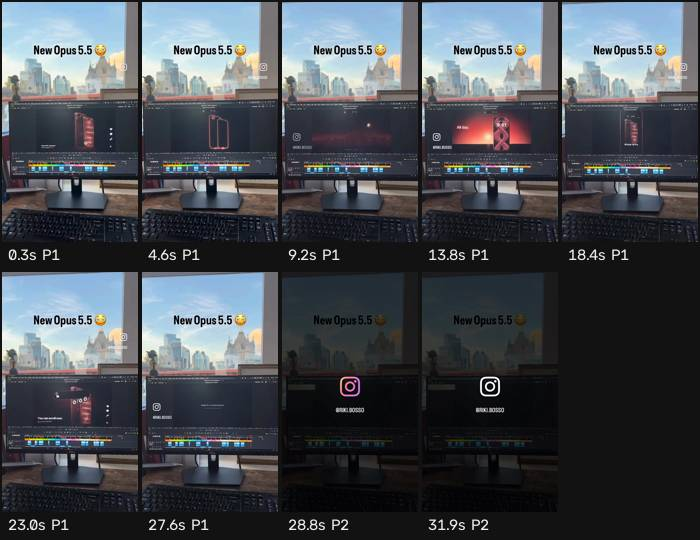

# Ficha de referencia · 11

Archivo `referencias/11.mp4` · 32,2 s · 576×1024 vertical (9:16) · 30,00 fps · audio 2 canal(es)

Generada el 2026-10-25 · transcripción small, idioma `en` · cortes con umbral 27.0.

## Ritmo en una mirada

- **Planos:** 2, uno cada 16,1 s de media (mediana 16,1 s, de 4,0 a 28,2 s) · 1,9 cortes por minuto.
- **Habla:** 47 palabras · 3,34 palabras/s mientras habla (1,46 sobre el total) · habla el 44% del video · primera palabra a los 0,00 s.
- **Bloques** (frases separadas por pausas de 0,30 s o fin de oración): 15, 3,0 palabras y 0,9 s de mediana (de 0,2 a 1,6 s).
- **Pausas** de 0,25 s o más: 13, mediana 0,50 s, la más larga 2,18 s.

## Planos

| # | inicio | fin | dura | qué se dice |
| --- | --- | --- | --- | --- |
| 1 | 0,00 | 28,17 | 28,17 | Hey guys, not so fast. Stay for 20 seconds. Sound off. iPhone 18 Pro. Look, everything waits. A 20 Pro doesn't. All day and all night. We're at 20 seconds? Yes. You thought this was your phone? You wish. Fine. You can scroll now. Worth stopping for. |
| 2 | 28,17 | 32,20 | 4,03 |  |

## Bloques de habla

| # | inicio | dura | palabras | pal/s | texto |
| --- | --- | --- | --- | --- | --- |
| 1 | 0,00 | 1,62 | 5 | 3,1 | Hey guys, not so fast. |
| 2 | 2,00 | 0,88 | 4 | 4,5 | Stay for 20 seconds. |
| 3 | 3,38 | 0,22 | 2 | 9,1 | Sound off. |
| 4 | 4,38 | 1,30 | 3 | 2,3 | iPhone 18 Pro. |
| 5 | 7,16 | 0,60 | 1 | 1,7 | Look, |
| 6 | 9,94 | 0,98 | 2 | 2,0 | everything waits. |
| 7 | 11,36 | 1,46 | 4 | 2,7 | A 20 Pro doesn't. |
| 8 | 13,24 | 1,46 | 5 | 3,4 | All day and all night. |
| 9 | 14,82 | 0,86 | 4 | 4,7 | We're at 20 seconds? |
| 10 | 16,02 | 0,28 | 1 | 3,6 | Yes. |
| 11 | 17,78 | 1,64 | 6 | 3,7 | You thought this was your phone? |
| 12 | 19,78 | 0,36 | 2 | 5,6 | You wish. |
| 13 | 21,86 | 0,60 | 1 | 1,7 | Fine. |
| 14 | 22,88 | 0,82 | 4 | 4,9 | You can scroll now. |
| 15 | 24,24 | 1,00 | 3 | 3,0 | Worth stopping for. |

## Tira de momentos clave

- 0,3 s · arranque · plano 1 · "Hey guys, not"
- 4,6 s · medio · plano 1 · "iPhone 18"
- 9,2 s · medio · plano 1
- 13,8 s · medio · plano 1 · "All day and all"
- 18,4 s · medio · plano 1 · "You thought this was your"
- 23,0 s · medio · plano 1 · "Fine. You can scroll now."
- 27,6 s · medio · plano 1
- 28,8 s · entra el plano · plano 2
- 31,9 s · final · plano 2

## Cómo usarla

- Los números son de la referencia: sirven de molde para el ritmo de cortes y de habla.
- Los bloques salen del habla, no de los subtítulos quemados en el video (no se leen). Para ver cómo están puestos los subtítulos, mirá la tira.
- Movimientos de cámara y estilo de subtítulos no se copian solos: se proponen en el plan que aprueba Juani.
