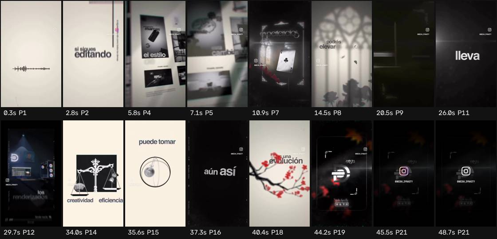

# Ficha de referencia · 12

Archivo `referencias/12.mp4` · 49,0 s · 576×1024 vertical (9:16) · 30,00 fps · audio 2 canal(es)

Generada el 2026-10-25 · transcripción small, idioma `en` · cortes con umbral 27.0.

## Ritmo en una mirada

- **Planos:** 21, uno cada 2,3 s de media (mediana 2,1 s, de 0,2 a 6,0 s) · 24,5 cortes por minuto.
- **Habla:** 138 palabras · 3,52 palabras/s mientras habla (2,82 sobre el total) · habla el 80% del video · primera palabra a los 0,00 s.
- **Bloques** (frases separadas por pausas de 0,30 s o fin de oración): 12, 9,0 palabras y 2,4 s de mediana (de 1,1 a 8,2 s).
- **Pausas** de 0,25 s o más: 11, mediana 0,34 s, la más larga 0,58 s.

## Planos

| # | inicio | fin | dura | qué se dice |
| --- | --- | --- | --- | --- |
| 1 | 0,00 | 2,23 | 2,23 | Within a saturated market of editors, |
| 2 | 2,23 | 4,30 | 2,07 | if you continue to edit like everyone else, it |
| 3 | 4,30 | 5,23 | 0,93 | will be invisible. |
| 4 | 5,23 | 6,53 | 1,30 | The 3D |
| 5 | 6,53 | 9,17 | 2,63 | editing style is completely changing the game, transforming |
| 6 | 9,17 | 10,33 | 1,17 | common content into |
| 7 | 10,33 | 13,90 | 3,57 | immersive visual experiences that catch your attention instantly. |
| 8 | 13,90 | 19,87 | 5,97 | You will be able to raise your quality and improve retention on platforms like Instagram or TikTok, where you will highlight the key. |
| 9 | 19,87 | 23,30 | 3,43 | In addition, you can open doors with brands and creators who are looking for something |
| 10 | 23,30 | 25,40 | 2,10 | unique, but not everything is easy. |
| 11 | 25,40 | 29,13 | 3,73 | Dominating it takes time, demanding managing advanced tools, and without a good |
| 12 | 29,13 | 30,50 | 1,37 | team, renderings can |
| 13 | 30,50 | 33,40 | 2,90 | be eternal. It also requires balance creativity and |
| 14 | 33,40 | 34,97 | 1,57 | efficiency, because each project |
| 15 | 34,97 | 36,73 | 1,77 | can take more than expected. |
| 16 | 36,73 | 38,73 | 2,00 | Even so, this editing style is not just |
| 17 | 38,73 | 39,77 | 1,03 | a trend, it is |
| 18 | 39,77 | 43,70 | 3,93 | an evolution, and if you try, the rewards can be enormous. |
| 19 | 43,70 | 44,67 | 0,97 |  |
| 20 | 44,67 | 44,90 | 0,23 |  |
| 21 | 44,90 | 48,97 | 4,07 |  |

## Bloques de habla

| # | inicio | dura | palabras | pal/s | texto |
| --- | --- | --- | --- | --- | --- |
| 1 | 0,00 | 4,76 | 18 | 3,8 | Within a saturated market of editors, if you continue to edit like everyone else, it will be invisible. |
| 2 | 5,34 | 8,18 | 21 | 2,6 | The 3D editing style is completely changing the game, transforming common content into immersive visual experiences that catch your attention instantly. |
| 3 | 14,04 | 4,20 | 17 | 4,0 | You will be able to raise your quality and improve retention on platforms like Instagram or TikTok, |
| 4 | 18,66 | 1,14 | 6 | 5,3 | where you will highlight the key. |
| 5 | 20,06 | 3,70 | 16 | 4,3 | In addition, you can open doors with brands and creators who are looking for something unique, |
| 6 | 24,10 | 1,14 | 5 | 4,4 | but not everything is easy. |
| 7 | 25,24 | 6,04 | 17 | 2,8 | Dominating it takes time, demanding managing advanced tools, and without a good team, renderings can be eternal. |
| 8 | 31,58 | 2,24 | 7 | 3,1 | It also requires balance creativity and efficiency, |
| 9 | 34,16 | 2,24 | 8 | 3,6 | because each project can take more than expected. |
| 10 | 36,68 | 2,52 | 10 | 4,0 | Even so, this editing style is not just a trend, |
| 11 | 39,58 | 1,40 | 8 | 5,7 | it is an evolution, and if you try, |
| 12 | 41,48 | 1,70 | 5 | 2,9 | the rewards can be enormous. |

## Tira de momentos clave

- 0,3 s · arranque · plano 1 · "Within a saturated"
- 2,8 s · entra el plano · plano 2 · "if you continue to edit like everyone"
- 5,8 s · entra el plano · plano 4 · "The 3D"
- 7,1 s · entra el plano · plano 5 · "3D editing style is completely changing"
- 10,9 s · entra el plano · plano 7 · "into immersive visual experiences that"
- 14,5 s · entra el plano · plano 8 · "You will be able to raise your quality and"
- 20,5 s · entra el plano · plano 9 · "In addition, you can open doors"
- 26,0 s · entra el plano · plano 11 · "Dominating it takes time,"
- 29,7 s · entra el plano · plano 12 · "team, renderings can"
- 34,0 s · entra el plano · plano 14 · "and efficiency, because each project"
- 35,6 s · entra el plano · plano 15 · "can take more than expected."
- 37,3 s · entra el plano · plano 16 · "Even so, this editing style"
- 40,4 s · entra el plano · plano 18 · "is an evolution, and if you try,"
- 44,2 s · entra el plano · plano 19
- 45,5 s · entra el plano · plano 21
- 48,7 s · final · plano 21

## Cómo usarla

- Los números son de la referencia: sirven de molde para el ritmo de cortes y de habla.
- Los bloques salen del habla, no de los subtítulos quemados en el video (no se leen). Para ver cómo están puestos los subtítulos, mirá la tira.
- Movimientos de cámara y estilo de subtítulos no se copian solos: se proponen en el plan que aprueba Juani.
