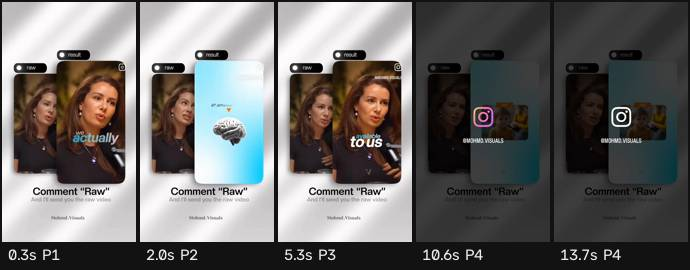

# Ficha de referencia · 13

Archivo `referencias/13.mp4` · 14,0 s · 464×832 vertical (29:52) · 30,00 fps · audio 2 canal(es)

Generada el 2026-10-25 · transcripción small, idioma `en` · cortes con umbral 27.0.

## Ritmo en una mirada

- **Planos:** 4, uno cada 3,5 s de media (mediana 3,6 s, de 1,4 a 5,3 s) · 12,9 cortes por minuto.
- **Habla:** 27 palabras · 2,90 palabras/s mientras habla (1,93 sobre el total) · habla el 66% del video · primera palabra a los 0,00 s.
- **Bloques** (frases separadas por pausas de 0,30 s o fin de oración): 2, 13,5 palabras y 4,7 s de mediana (de 3,9 a 5,4 s).
- **Pausas** de 0,25 s o más: 1, mediana 0,26 s, la más larga 0,26 s.

## Planos

| # | inicio | fin | dura | qué se dice |
| --- | --- | --- | --- | --- |
| 1 | 0,00 | 1,40 | 1,40 | We actually have over |
| 2 | 1,40 | 4,67 | 3,27 | 87 different emotions and emotional experiences available |
| 3 | 4,67 | 9,97 | 5,30 | to us. And the average human can only name three within themselves, happy, angry and sad. |
| 4 | 9,97 | 14,00 | 4,03 |  |

## Bloques de habla

| # | inicio | dura | palabras | pal/s | texto |
| --- | --- | --- | --- | --- | --- |
| 1 | 0,00 | 5,42 | 13 | 2,4 | We actually have over 87 different emotions and emotional experiences available to us. |
| 2 | 5,68 | 3,88 | 14 | 3,6 | And the average human can only name three within themselves, happy, angry and sad. |

## Tira de momentos clave

- 0,3 s · arranque · plano 1 · "We actually have over"
- 2,0 s · entra el plano · plano 2 · "87 different"
- 5,3 s · entra el plano · plano 3 · "available to us. And the"
- 10,6 s · entra el plano · plano 4
- 13,7 s · final · plano 4

## Cómo usarla

- Los números son de la referencia: sirven de molde para el ritmo de cortes y de habla.
- Los bloques salen del habla, no de los subtítulos quemados en el video (no se leen). Para ver cómo están puestos los subtítulos, mirá la tira.
- Movimientos de cámara y estilo de subtítulos no se copian solos: se proponen en el plan que aprueba Juani.
