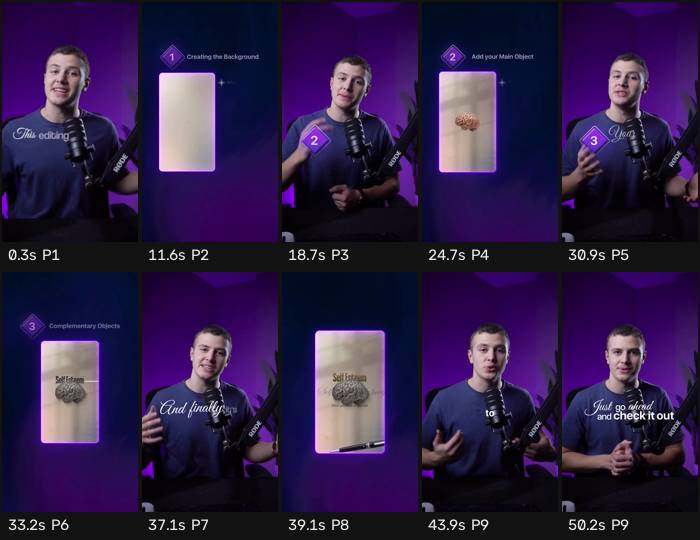

# Ficha de referencia · 2

Archivo `referencias/2.mp4` · 50,5 s · 720×1280 vertical (9:16) · 30,00 fps · audio 2 canal(es)

Generada el 2026-10-25 · transcripción small, idioma `en` · cortes con umbral 27.0.

## Ritmo en una mirada

- **Planos:** 9, uno cada 5,6 s de media (mediana 6,1 s, de 2,1 a 11,0 s) · 9,5 cortes por minuto.
- **Habla:** 187 palabras · 4,12 palabras/s mientras habla (3,71 sobre el total) · habla el 90% del video · primera palabra a los 0,00 s.
- **Bloques** (frases separadas por pausas de 0,30 s o fin de oración): 18, 9,0 palabras y 2,0 s de mediana (de 0,9 a 5,6 s).
- **Pausas** de 0,25 s o más: 12, mediana 0,33 s, la más larga 0,44 s.

## Planos

| # | inicio | fin | dura | qué se dice |
| --- | --- | --- | --- | --- |
| 1 | 0,00 | 11,03 | 11,03 | This editing style is taking over in 2026 and every single editor wants to learn it. So here's a quick breakdown of how it's made. There's really three steps to making this editing style. First is the background. |
| 2 | 11,03 | 18,07 | 7,03 | The background is typically white, layered on with a grid effect. It also has a half -told texture and even a casted shadow. |
| 3 | 18,07 | 24,13 | 6,07 | The second step is your main object. There are two types of scenes in this editing style. Object centric and text centric. |
| 4 | 24,13 | 30,30 | 6,17 | Just take your main object and place it in the middle. Then stylize it with desaturation, a texture and a casted shadow. The |
| 5 | 30,30 | 32,57 | 2,27 | third step is your complementary object. |
| 6 | 32,57 | 36,47 | 3,90 | This is the text that comes behind or around your object to help visualize it. |
| 7 | 36,47 | 38,53 | 2,07 | And finally, it's your depth elements. |
| 8 | 38,53 | 43,27 | 4,73 | These are the elements on the edges of the screen with a blur and a darken effect to give you some depth. |
| 9 | 43,27 | 50,33 | 7,07 | If you would like to watch me create this scene over here step by step, I've made a full tutorial breaking it down on YouTube. Just go ahead and check it out. |

## Bloques de habla

| # | inicio | dura | palabras | pal/s | texto |
| --- | --- | --- | --- | --- | --- |
| 1 | 0,00 | 4,76 | 16 | 3,4 | This editing style is taking over in 2026 and every single editor wants to learn it. |
| 2 | 4,94 | 1,90 | 9 | 4,7 | So here's a quick breakdown of how it's made. |
| 3 | 7,10 | 2,34 | 9 | 3,8 | There's really three steps to making this editing style. |
| 4 | 9,82 | 0,96 | 4 | 4,2 | First is the background. |
| 5 | 11,04 | 1,32 | 5 | 3,8 | The background is typically white, |
| 6 | 12,72 | 1,22 | 6 | 4,9 | layered on with a grid effect. |
| 7 | 14,30 | 3,48 | 12 | 3,4 | It also has a half -told texture and even a casted shadow. |
| 8 | 18,08 | 1,68 | 7 | 4,2 | The second step is your main object. |
| 9 | 20,14 | 1,94 | 10 | 5,2 | There are two types of scenes in this editing style. |
| 10 | 22,36 | 1,62 | 5 | 3,1 | Object centric and text centric. |
| 11 | 24,14 | 1,98 | 11 | 5,6 | Just take your main object and place it in the middle. |
| 12 | 26,12 | 3,78 | 11 | 2,9 | Then stylize it with desaturation, a texture and a casted shadow. |
| 13 | 30,14 | 2,02 | 7 | 3,5 | The third step is your complementary object. |
| 14 | 32,52 | 3,78 | 15 | 4,0 | This is the text that comes behind or around your object to help visualize it. |
| 15 | 36,50 | 1,62 | 6 | 3,7 | And finally, it's your depth elements. |
| 16 | 38,56 | 4,48 | 22 | 4,9 | These are the elements on the edges of the screen with a blur and a darken effect to give you some depth. |
| 17 | 43,30 | 5,64 | 25 | 4,4 | If you would like to watch me create this scene over here step by step, I've made a full tutorial breaking it down on YouTube. |
| 18 | 49,22 | 0,90 | 7 | 7,8 | Just go ahead and check it out. |

## Tira de momentos clave

- 0,3 s · arranque · plano 1 · "This editing style is"
- 11,6 s · entra el plano · plano 2 · "The background is typically white,"
- 18,7 s · entra el plano · plano 3 · "The second step is your main"
- 24,7 s · entra el plano · plano 4 · "Just take your main object and"
- 30,9 s · entra el plano · plano 5 · "third step is your complementary"
- 33,2 s · entra el plano · plano 6 · "This is the text that comes behind"
- 37,1 s · entra el plano · plano 7 · "And finally, it's your depth elements."
- 39,1 s · entra el plano · plano 8 · "These are the elements on the edges"
- 43,9 s · entra el plano · plano 9 · "If you would like to watch me create"
- 50,1 s · final · plano 9 · "ahead and check it out."

## Cómo usarla

- Los números son de la referencia: sirven de molde para el ritmo de cortes y de habla.
- Los bloques salen del habla, no de los subtítulos quemados en el video (no se leen). Para ver cómo están puestos los subtítulos, mirá la tira.
- Movimientos de cámara y estilo de subtítulos no se copian solos: se proponen en el plan que aprueba Juani.
