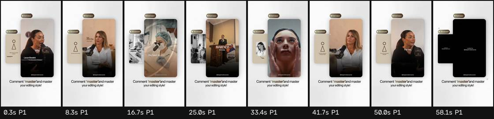

# Ficha de referencia · 3

Archivo `referencias/3.mp4` · 58,4 s · 720×1280 vertical (9:16) · 30,00 fps · audio 2 canal(es)

Generada el 2026-10-25 · transcripción small, idioma `en` · cortes con umbral 27.0.

## Ritmo en una mirada

- **Planos:** 1, uno cada 58,4 s de media (mediana 58,4 s, de 58,4 a 58,4 s) · 0,0 cortes por minuto.
- **Habla:** 178 palabras · 3,39 palabras/s mientras habla (3,05 sobre el total) · habla el 90% del video · primera palabra a los 0,00 s.
- **Bloques** (frases separadas por pausas de 0,30 s o fin de oración): 14, 10,5 palabras y 3,2 s de mediana (de 0,2 a 7,7 s).
- **Pausas** de 0,25 s o más: 6, mediana 0,30 s, la más larga 0,36 s.

## Planos

| # | inicio | fin | dura | qué se dice |
| --- | --- | --- | --- | --- |
| 1 | 0,00 | 58,39 | 58,39 | Why is the sun cancer rate up? The sunscreen paradox is really, it's real. And we are using sunscreen more than ever, but one in five women get skin cancer and one in seven men get skin cancer. It's the most prevalent form of cancer. For a problem like this, you have to start by measuring it. And we have never had a tool to really measure the exposure that we've had on a long -term basis. I mean, awareness is really the first step. What are the massive blind spots that dermatologists are missing? Dermatology community has been very black or white on this issue. You apply sunscreen and you supplement with vitamin D. Right. I think the blind spot is the lack of data and we're going to be providing that data to people. But this is all about empowerment because our thinking on this has really evolved to understand how sunlight impacts our overall health. To me, this is the best wearable because it's teaching me to be preventative and aware of my sun exposure. |

## Bloques de habla

| # | inicio | dura | palabras | pal/s | texto |
| --- | --- | --- | --- | --- | --- |
| 1 | 0,00 | 2,94 | 7 | 2,4 | Why is the sun cancer rate up? |
| 2 | 3,22 | 1,98 | 7 | 3,5 | The sunscreen paradox is really, it's real. |
| 3 | 5,50 | 6,66 | 24 | 3,6 | And we are using sunscreen more than ever, but one in five women get skin cancer and one in seven men get skin cancer. |
| 4 | 12,32 | 2,22 | 7 | 3,2 | It's the most prevalent form of cancer. |
| 5 | 14,84 | 2,96 | 12 | 4,1 | For a problem like this, you have to start by measuring it. |
| 6 | 17,88 | 5,08 | 20 | 3,9 | And we have never had a tool to really measure the exposure that we've had on a long -term basis. |
| 7 | 23,32 | 1,96 | 8 | 4,1 | I mean, awareness is really the first step. |
| 8 | 25,30 | 3,64 | 10 | 2,7 | What are the massive blind spots that dermatologists are missing? |
| 9 | 28,94 | 3,54 | 11 | 3,1 | Dermatology community has been very black or white on this issue. |
| 10 | 32,72 | 2,88 | 9 | 3,1 | You apply sunscreen and you supplement with vitamin D. |
| 11 | 35,78 | 0,16 | 1 | 6,3 | Right. |
| 12 | 36,10 | 5,22 | 20 | 3,8 | I think the blind spot is the lack of data and we're going to be providing that data to people. |
| 13 | 41,62 | 7,72 | 22 | 2,8 | But this is all about empowerment because our thinking on this has really evolved to understand how sunlight impacts our overall health. |
| 14 | 49,70 | 5,56 | 20 | 3,6 | To me, this is the best wearable because it's teaching me to be preventative and aware of my sun exposure. |

## Tira de momentos clave

- 0,3 s · arranque · plano 1 · "Why is"
- 8,3 s · medio · plano 1 · "but one in five women get"
- 16,7 s · medio · plano 1 · "you have to start by measuring"
- 25,0 s · medio · plano 1 · "the first step. What are"
- 33,4 s · medio · plano 1 · "You apply sunscreen and"
- 41,7 s · medio · plano 1 · "people. But this is all"
- 50,0 s · medio · plano 1 · "To me, this is the"
- 58,1 s · final · plano 1

## Cómo usarla

- Los números son de la referencia: sirven de molde para el ritmo de cortes y de habla.
- Los bloques salen del habla, no de los subtítulos quemados en el video (no se leen). Para ver cómo están puestos los subtítulos, mirá la tira.
- Movimientos de cámara y estilo de subtítulos no se copian solos: se proponen en el plan que aprueba Juani.
