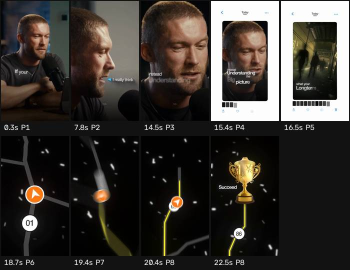

# Ficha de referencia · 4

Archivo `referencias/4.mp4` · 22,8 s · 720×1280 vertical (9:16) · 30,00 fps · audio 2 canal(es)

Generada el 2026-10-25 · transcripción small, idioma `en` · cortes con umbral 27.0.

## Ritmo en una mirada

- **Planos:** 8, uno cada 2,8 s de media (mediana 1,7 s, de 0,7 a 7,2 s) · 18,4 cortes por minuto.
- **Habla:** 83 palabras · 4,12 palabras/s mientras habla (3,64 sobre el total) · habla el 88% del video · primera palabra a los 0,00 s.
- **Bloques** (frases separadas por pausas de 0,30 s o fin de oración): 5, 11,0 palabras y 3,1 s de mediana (de 0,9 a 6,7 s).
- **Pausas** de 0,25 s o más: 4, mediana 0,36 s, la más larga 0,46 s.

## Planos

| # | inicio | fin | dura | qué se dice |
| --- | --- | --- | --- | --- |
| 1 | 0,00 | 7,23 | 7,23 | If your definition of success is win or lose, giving everything you've got and growing or learning along the way, then you're setting yourself up for success. |
| 2 | 7,23 | 14,07 | 6,83 | I really think the biggest cheat code in life is just going after it and not being concerned of whether or not you fail at one specific task. |
| 3 | 14,07 | 14,97 | 0,90 | Instead understanding |
| 4 | 14,97 | 15,90 | 0,93 | the big picture, |
| 5 | 15,90 | 18,33 | 2,43 | what your long -term goal is, and knowing if you |
| 6 | 18,33 | 19,00 | 0,67 | keep driving forward |
| 7 | 19,00 | 19,80 | 0,80 | and never |
| 8 | 19,80 | 22,67 | 2,87 | fucking quit, in the end you will succeed. |

## Bloques de habla

| # | inicio | dura | palabras | pal/s | texto |
| --- | --- | --- | --- | --- | --- |
| 1 | 0,00 | 6,72 | 27 | 4,0 | If your definition of success is win or lose, giving everything you've got and growing or learning along the way, then you're setting yourself up for success. |
| 2 | 7,18 | 6,58 | 28 | 4,3 | I really think the biggest cheat code in life is just going after it and not being concerned of whether or not you fail at one specific task. |
| 3 | 13,90 | 3,12 | 11 | 3,5 | Instead understanding the big picture, what your long -term goal is, |
| 4 | 17,44 | 2,80 | 11 | 3,9 | and knowing if you keep driving forward and never fucking quit, |
| 5 | 20,54 | 0,94 | 6 | 6,4 | in the end you will succeed. |

## Tira de momentos clave

- 0,3 s · arranque · plano 1 · "If your definition of success"
- 7,8 s · entra el plano · plano 2 · "I really think the biggest cheat"
- 14,5 s · entra el plano · plano 3 · "Instead understanding the"
- 15,4 s · entra el plano · plano 4 · "understanding the big picture, what your"
- 16,5 s · entra el plano · plano 5 · "what your long -term goal is,"
- 18,7 s · entra el plano · plano 6 · "if you keep driving forward and"
- 19,4 s · entra el plano · plano 7 · "forward and never fucking quit,"
- 20,4 s · entra el plano · plano 8 · "fucking quit, in the end you"
- 22,5 s · final · plano 8

## Cómo usarla

- Los números son de la referencia: sirven de molde para el ritmo de cortes y de habla.
- Los bloques salen del habla, no de los subtítulos quemados en el video (no se leen). Para ver cómo están puestos los subtítulos, mirá la tira.
- Movimientos de cámara y estilo de subtítulos no se copian solos: se proponen en el plan que aprueba Juani.
