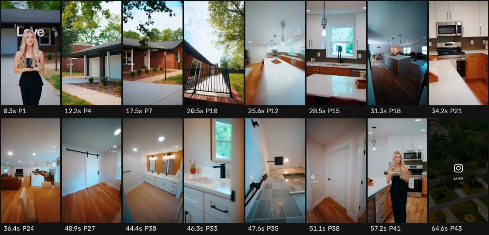

# Ficha de referencia · 5

Archivo `referencias/5.mp4` · 64,9 s · 576×1024 vertical (9:16) · 30,00 fps · audio 2 canal(es)

Generada el 2026-10-25 · transcripción small, idioma `en` · cortes con umbral 27.0.

## Ritmo en una mirada

- **Planos:** 43, uno cada 1,5 s de media (mediana 1,2 s, de 0,5 a 7,8 s) · 38,8 cortes por minuto.
- **Habla:** 48 palabras · 2,70 palabras/s mientras habla (0,74 sobre el total) · habla el 27% del video · primera palabra a los 0,00 s.
- **Bloques** (frases separadas por pausas de 0,30 s o fin de oración): 5, 10,0 palabras y 2,8 s de mediana (de 2,0 a 6,2 s).
- **Pausas** de 0,25 s o más: 4, mediana 1,84 s, la más larga 36,32 s.

## Planos

| # | inicio | fin | dura | qué se dice |
| --- | --- | --- | --- | --- |
| 1 | 0,00 | 7,77 | 7,77 | If you love the finishes on this property, then you will love this fully remodeled, single -level Albuquerque space |
| 2 | 7,77 | 10,53 | 2,77 | located |
| 3 | 10,53 | 11,63 | 1,10 |  |
| 4 | 11,63 | 12,83 | 1,20 | in |
| 5 | 12,83 | 14,33 | 1,50 | Lincolnton, North Carolina |
| 6 | 14,33 | 17,03 | 2,70 | in a highly desirable, matured neighborhood. |
| 7 | 17,03 | 17,93 | 0,90 | Myseller knows the |
| 8 | 17,93 | 19,10 | 1,17 | finishes you love and |
| 9 | 19,10 | 19,87 | 0,77 | they're right here. |
| 10 | 19,87 | 22,50 | 2,63 |  |
| 11 | 22,50 | 24,97 | 2,47 |  |
| 12 | 24,97 | 26,33 | 1,37 |  |
| 13 | 26,33 | 27,53 | 1,20 |  |
| 14 | 27,53 | 28,27 | 0,73 |  |
| 15 | 28,27 | 28,73 | 0,47 |  |
| 16 | 28,73 | 30,13 | 1,40 |  |
| 17 | 30,13 | 30,70 | 0,57 |  |
| 18 | 30,70 | 32,00 | 1,30 |  |
| 19 | 32,00 | 32,63 | 0,63 |  |
| 20 | 32,63 | 33,93 | 1,30 |  |
| 21 | 33,93 | 34,57 | 0,63 |  |
| 22 | 34,57 | 35,20 | 0,63 |  |
| 23 | 35,20 | 35,83 | 0,63 |  |
| 24 | 35,83 | 37,70 | 1,87 |  |
| 25 | 37,70 | 38,97 | 1,27 |  |
| 26 | 38,97 | 40,27 | 1,30 |  |
| 27 | 40,27 | 42,27 | 2,00 |  |
| 28 | 42,27 | 43,47 | 1,20 |  |
| 29 | 43,47 | 44,10 | 0,63 |  |
| 30 | 44,10 | 44,73 | 0,63 |  |
| 31 | 44,73 | 45,27 | 0,53 |  |
| 32 | 45,27 | 46,00 | 0,73 |  |
| 33 | 46,00 | 46,63 | 0,63 |  |
| 34 | 46,63 | 47,30 | 0,67 |  |
| 35 | 47,30 | 47,93 | 0,63 |  |
| 36 | 47,93 | 48,57 | 0,63 |  |
| 37 | 48,57 | 50,47 | 1,90 |  |
| 38 | 50,47 | 51,73 | 1,27 |  |
| 39 | 51,73 | 54,87 | 3,13 |  |
| 40 | 54,87 | 56,60 | 1,73 | Contacting |
| 41 | 56,60 | 58,43 | 1,83 | today while we're still on the market. |
| 42 | 58,43 | 60,83 | 2,40 |  |
| 43 | 60,83 | 64,87 | 4,03 |  |

## Bloques de habla

| # | inicio | dura | palabras | pal/s | texto |
| --- | --- | --- | --- | --- | --- |
| 1 | 0,00 | 2,66 | 8 | 3,0 | If you love the finishes on this property, |
| 2 | 3,08 | 6,16 | 12 | 1,9 | then you will love this fully remodeled, single -level Albuquerque space located |
| 3 | 12,50 | 4,12 | 10 | 2,4 | in Lincolnton, North Carolina in a highly desirable, matured neighborhood. |
| 4 | 16,90 | 2,80 | 10 | 3,6 | Myseller knows the finishes you love and they're right here. |
| 5 | 56,02 | 2,04 | 8 | 3,9 | Contacting today while we're still on the market. |

## Tira de momentos clave

- 0,3 s · arranque · plano 1 · "If you love the"
- 12,2 s · entra el plano · plano 4 · "in"
- 17,5 s · entra el plano · plano 7 · "Myseller knows the finishes"
- 20,5 s · entra el plano · plano 10
- 25,6 s · entra el plano · plano 12
- 28,5 s · entra el plano · plano 15
- 31,3 s · entra el plano · plano 18
- 34,2 s · entra el plano · plano 21
- 36,4 s · entra el plano · plano 24
- 40,9 s · entra el plano · plano 27
- 44,4 s · entra el plano · plano 30
- 46,3 s · entra el plano · plano 33
- 47,6 s · entra el plano · plano 35
- 51,1 s · entra el plano · plano 38
- 57,2 s · entra el plano · plano 41 · "Contacting today while we're still on the"
- 64,6 s · final · plano 43

## Cómo usarla

- Los números son de la referencia: sirven de molde para el ritmo de cortes y de habla.
- Los bloques salen del habla, no de los subtítulos quemados en el video (no se leen). Para ver cómo están puestos los subtítulos, mirá la tira.
- Movimientos de cámara y estilo de subtítulos no se copian solos: se proponen en el plan que aprueba Juani.
