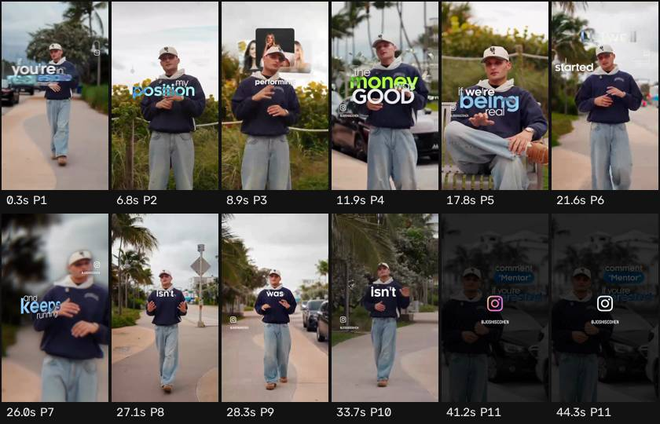

# Ficha de referencia · 6

Archivo `referencias/6.mp4` · 44,6 s · 576×1024 vertical (9:16) · 29,98 fps (VARIABLE) · audio 2 canal(es)

Generada el 2026-10-25 · transcripción small, idioma `en` · cortes con umbral 27.0.

## Ritmo en una mirada

- **Planos:** 11, uno cada 4,1 s de media (mediana 4,0 s, de 1,1 a 7,5 s) · 13,4 cortes por minuto.
- **Habla:** 163 palabras · 4,74 palabras/s mientras habla (3,65 sobre el total) · habla el 77% del video · primera palabra a los 0,00 s.
- **Bloques** (frases separadas por pausas de 0,30 s o fin de oración): 18, 8,5 palabras y 1,7 s de mediana (de 0,6 a 6,0 s).
- **Pausas** de 0,25 s o más: 10, mediana 0,38 s, la más larga 0,52 s.

## Planos

| # | inicio | fin | dura | qué se dice |
| --- | --- | --- | --- | --- |
| 1 | 0,00 | 6,22 | 6,22 | If you're in real estate media doing over 10k a month and the whole thing stops the second you stop shooting, I've been in your exact position. |
| 2 | 6,22 | 8,35 | 2,12 | My position was flying around the country shooting |
| 3 | 8,35 | 11,35 | 3,00 | top performing agents, but I shut that down anyway. |
| 4 | 11,35 | 17,15 | 5,80 | The money was good, but every dollar depended on me getting on the next flight. And if I stopped flying, started the income. |
| 5 | 17,15 | 21,00 | 3,85 | And if we're being real, that isn't a business. It's an expensive job with a camera. |
| 6 | 21,00 | 25,43 | 4,43 | I started Listwell to prove the opposite as possible. A real estate media company that scales and |
| 7 | 25,43 | 26,50 | 1,07 | keeps running even |
| 8 | 26,50 | 27,68 | 1,18 | when the owner isn't in it. The |
| 9 | 27,68 | 33,10 | 5,43 | goal was never a bigger media company. It was one that runs when I'm not in it. And I'm going to teach you exactly how I do it. |
| 10 | 33,10 | 40,65 | 7,55 | But this isn't for someone who just bought a camera. It's for owners already scaled past 10k a month. So if you're interested, comment mentor. |
| 11 | 40,65 | 44,62 | 3,98 |  |

## Bloques de habla

| # | inicio | dura | palabras | pal/s | texto |
| --- | --- | --- | --- | --- | --- |
| 1 | 0,00 | 5,96 | 27 | 4,5 | If you're in real estate media doing over 10k a month and the whole thing stops the second you stop shooting, I've been in your exact position. |
| 2 | 6,34 | 3,10 | 11 | 3,5 | My position was flying around the country shooting top performing agents, |
| 3 | 9,82 | 1,06 | 6 | 5,7 | but I shut that down anyway. |
| 4 | 11,40 | 3,40 | 15 | 4,4 | The money was good, but every dollar depended on me getting on the next flight. |
| 5 | 14,98 | 0,86 | 5 | 5,8 | And if I stopped flying, |
| 6 | 16,16 | 0,58 | 3 | 5,2 | started the income. |
| 7 | 17,12 | 0,74 | 5 | 6,8 | And if we're being real, |
| 8 | 18,16 | 0,62 | 4 | 6,5 | that isn't a business. |
| 9 | 19,08 | 1,60 | 7 | 4,4 | It's an expensive job with a camera. |
| 10 | 21,00 | 2,26 | 9 | 4,0 | I started Listwell to prove the opposite as possible. |
| 11 | 23,46 | 3,98 | 17 | 4,3 | A real estate media company that scales and keeps running even when the owner isn't in it. |
| 12 | 27,56 | 1,72 | 8 | 4,7 | The goal was never a bigger media company. |
| 13 | 29,28 | 1,72 | 10 | 5,8 | It was one that runs when I'm not in it. |
| 14 | 31,20 | 1,74 | 11 | 6,3 | And I'm going to teach you exactly how I do it. |
| 15 | 33,18 | 1,56 | 10 | 6,4 | But this isn't for someone who just bought a camera. |
| 16 | 34,96 | 2,14 | 9 | 4,2 | It's for owners already scaled past 10k a month. |
| 17 | 37,52 | 0,70 | 4 | 5,7 | So if you're interested, |
| 18 | 38,72 | 0,64 | 2 | 3,1 | comment mentor. |

## Tira de momentos clave

- 0,3 s · arranque · plano 1 · "If you're in real estate media"
- 6,8 s · entra el plano · plano 2 · "My position was flying around"
- 8,9 s · entra el plano · plano 3 · "shooting top performing agents,"
- 11,9 s · entra el plano · plano 4 · "The money was good, but every"
- 17,8 s · entra el plano · plano 5 · "And if we're being real, that isn't"
- 21,6 s · entra el plano · plano 6 · "I started Listwell to prove the"
- 26,0 s · entra el plano · plano 7 · "and keeps running even when"
- 27,1 s · entra el plano · plano 8 · "when the owner isn't in it. The"
- 28,3 s · entra el plano · plano 9 · "The goal was never a bigger media"
- 33,7 s · entra el plano · plano 10 · "But this isn't for someone who just bought"
- 41,2 s · entra el plano · plano 11
- 44,3 s · final · plano 11

## Cómo usarla

- Los números son de la referencia: sirven de molde para el ritmo de cortes y de habla.
- Los bloques salen del habla, no de los subtítulos quemados en el video (no se leen). Para ver cómo están puestos los subtítulos, mirá la tira.
- Movimientos de cámara y estilo de subtítulos no se copian solos: se proponen en el plan que aprueba Juani.
