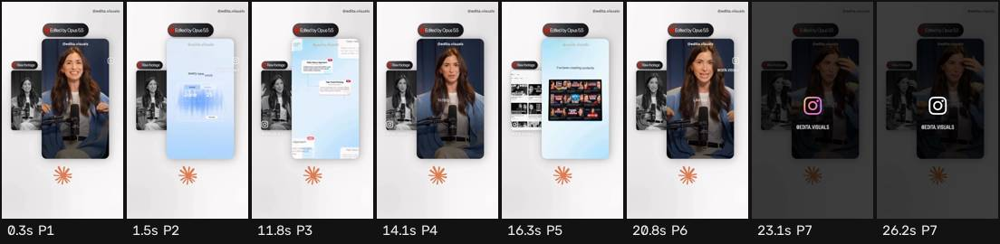

# Ficha de referencia · 7

Archivo `referencias/7.mp4` · 26,5 s · 464×832 vertical (29:52) · 30,00 fps · audio 2 canal(es)

Generada el 2026-10-25 · transcripción small, idioma `en` · cortes con umbral 27.0.

## Ritmo en una mirada

- **Planos:** 7, uno cada 3,8 s de media (mediana 2,4 s, de 0,9 a 10,3 s) · 13,6 cortes por minuto.
- **Habla:** 60 palabras · 2,93 palabras/s mientras habla (2,26 sobre el total) · habla el 77% del video · primera palabra a los 0,00 s.
- **Bloques** (frases separadas por pausas de 0,30 s o fin de oración): 5, 12,0 palabras y 4,4 s de mediana (de 1,6 a 7,0 s).
- **Pausas** de 0,25 s o más: 3, mediana 0,46 s, la más larga 0,58 s.

## Planos

| # | inicio | fin | dura | qué se dice |
| --- | --- | --- | --- | --- |
| 1 | 0,00 | 0,87 | 0,87 | It feels like every |
| 2 | 0,87 | 11,17 | 10,30 | new week in 2025 is a new life. Like we're starting from scratch. There is this new AI tool that we're integrating. There is this new strategy |
| 3 | 11,17 | 13,53 | 2,37 | and we're hiring more people to |
| 4 | 13,53 | 15,67 | 2,13 | help us with all of that. So I've been creating |
| 5 | 15,67 | 20,17 | 4,50 | content for 10 years but I've never experienced anything like |
| 6 | 20,17 | 22,50 | 2,33 | this, like 2025. |
| 7 | 22,50 | 26,50 | 4,00 |  |

## Bloques de habla

| # | inicio | dura | palabras | pal/s | texto |
| --- | --- | --- | --- | --- | --- |
| 1 | 0,00 | 5,06 | 12 | 2,4 | It feels like every new week in 2025 is a new life. |
| 2 | 5,36 | 1,58 | 5 | 3,2 | Like we're starting from scratch. |
| 3 | 7,52 | 2,42 | 9 | 3,7 | There is this new AI tool that we're integrating. |
| 4 | 10,40 | 4,42 | 17 | 3,8 | There is this new strategy and we're hiring more people to help us with all of that. |
| 5 | 15,02 | 6,98 | 17 | 2,4 | So I've been creating content for 10 years but I've never experienced anything like this, like 2025. |

## Tira de momentos clave

- 0,3 s · arranque · plano 1 · "It feels like every"
- 1,5 s · entra el plano · plano 2 · "every new week"
- 11,8 s · entra el plano · plano 3 · "strategy and we're hiring"
- 14,1 s · entra el plano · plano 4 · "to help us with all of that."
- 16,3 s · entra el plano · plano 5 · "creating content for 10 years"
- 20,8 s · entra el plano · plano 6 · "like this, like 2025."
- 23,1 s · entra el plano · plano 7
- 26,2 s · final · plano 7

## Cómo usarla

- Los números son de la referencia: sirven de molde para el ritmo de cortes y de habla.
- Los bloques salen del habla, no de los subtítulos quemados en el video (no se leen). Para ver cómo están puestos los subtítulos, mirá la tira.
- Movimientos de cámara y estilo de subtítulos no se copian solos: se proponen en el plan que aprueba Juani.
