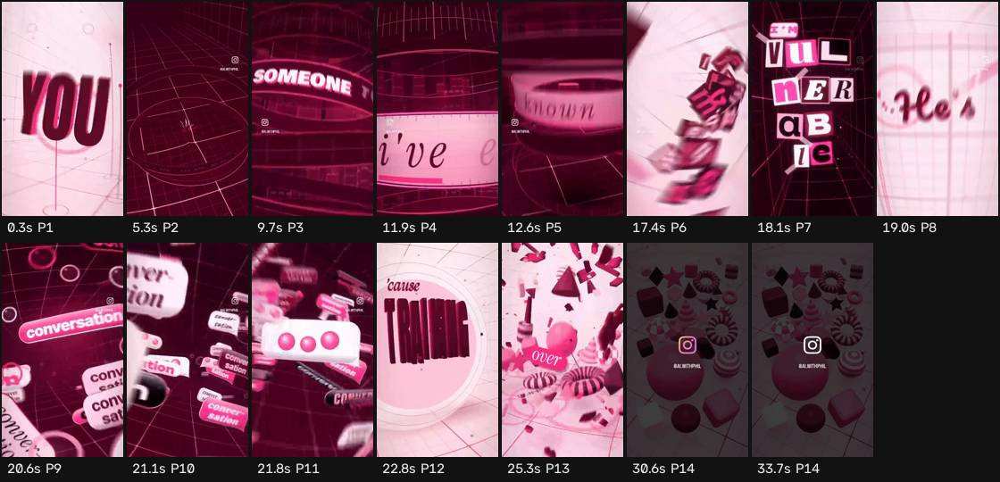

# Ficha de referencia · 8

Archivo `referencias/8.mp4` · 34,0 s · 576×1024 vertical (9:16) · 30,00 fps · audio 2 canal(es)

Generada el 2026-10-25 · transcripción small, idioma `en` · cortes con umbral 27.0.

## Ritmo en una mirada

- **Planos:** 14, uno cada 2,4 s de media (mediana 2,2 s, de 0,3 a 5,3 s) · 22,9 cortes por minuto.
- **Habla:** 5 palabras · 3,01 palabras/s mientras habla (0,15 sobre el total) · habla el 5% del video · primera palabra a los 14,96 s.
- **Bloques** (frases separadas por pausas de 0,30 s o fin de oración): 1, 5,0 palabras y 1,7 s de mediana (de 1,7 a 1,7 s).
- **Pausas** de 0,25 s o más: 0.

## Planos

| # | inicio | fin | dura | qué se dice |
| --- | --- | --- | --- | --- |
| 1 | 0,00 | 4,73 | 4,73 |  |
| 2 | 4,73 | 9,13 | 4,40 |  |
| 3 | 9,13 | 11,73 | 2,60 |  |
| 4 | 11,73 | 12,00 | 0,27 |  |
| 5 | 12,00 | 16,90 | 4,90 | Just how to take control |
| 6 | 16,90 | 17,90 | 1,00 |  |
| 7 | 17,90 | 18,40 | 0,50 |  |
| 8 | 18,40 | 20,33 | 1,93 |  |
| 9 | 20,33 | 20,93 | 0,60 |  |
| 10 | 20,93 | 21,30 | 0,37 |  |
| 11 | 21,30 | 22,20 | 0,90 |  |
| 12 | 22,20 | 24,73 | 2,53 |  |
| 13 | 24,73 | 30,00 | 5,27 |  |
| 14 | 30,00 | 34,00 | 4,00 |  |

## Bloques de habla

| # | inicio | dura | palabras | pal/s | texto |
| --- | --- | --- | --- | --- | --- |
| 1 | 14,96 | 1,66 | 5 | 3,0 | Just how to take control |

## Tira de momentos clave

- 0,3 s · arranque · plano 1
- 5,3 s · entra el plano · plano 2
- 9,7 s · entra el plano · plano 3
- 11,9 s · entra el plano · plano 4
- 12,6 s · entra el plano · plano 5
- 17,4 s · entra el plano · plano 6
- 18,1 s · entra el plano · plano 7
- 19,0 s · entra el plano · plano 8
- 20,6 s · entra el plano · plano 9
- 21,1 s · entra el plano · plano 10
- 21,8 s · entra el plano · plano 11
- 22,8 s · entra el plano · plano 12
- 25,3 s · entra el plano · plano 13
- 30,6 s · entra el plano · plano 14
- 33,7 s · final · plano 14

## Cómo usarla

- Los números son de la referencia: sirven de molde para el ritmo de cortes y de habla.
- Los bloques salen del habla, no de los subtítulos quemados en el video (no se leen). Para ver cómo están puestos los subtítulos, mirá la tira.
- Movimientos de cámara y estilo de subtítulos no se copian solos: se proponen en el plan que aprueba Juani.
