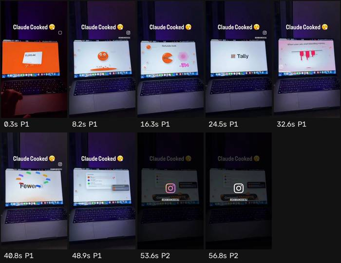

# Ficha de referencia · 9

Archivo `referencias/9.mp4` · 57,1 s · 576×1024 vertical (9:16) · 24,41 fps (VARIABLE) · audio 2 canal(es)

Generada el 2026-10-25 · transcripción small, idioma `en` · cortes con umbral 27.0.

## Ritmo en una mirada

- **Planos:** 2, uno cada 28,6 s de media (mediana 28,6 s, de 4,0 a 53,0 s) · 1,1 cortes por minuto.
- **Habla:** 109 palabras · 2,39 palabras/s mientras habla (1,91 sobre el total) · habla el 80% del video · primera palabra a los 1,36 s.
- **Bloques** (frases separadas por pausas de 0,30 s o fin de oración): 5, 6,0 palabras y 2,1 s de mediana (de 1,9 a 31,3 s).
- **Pausas** de 0,25 s o más: 4, mediana 0,54 s, la más larga 0,98 s.

## Planos

| # | inicio | fin | dura | qué se dice |
| --- | --- | --- | --- | --- |
| 1 | 0,00 | 53,05 | 53,05 | Your dashboard is lying to you. It says you made 1284 today. You actually kept 412 So where the rest go fees 8164 ads burned 398 refunds took 96 and shipping 214 and you only find out at midnight with 14 tabs open So we built tally every store every payout every ad account Melted into one number the real one when your ads start bleeding money It taps you on the shoulder one swipe paused every morning before coffee, you know exactly where you stand fewer tabs more sleep tally Oh, and this whole video made with AI every single frame comment prompts and I'll send you out |
| 2 | 53,05 | 57,10 | 4,05 |  |

## Bloques de habla

| # | inicio | dura | palabras | pal/s | texto |
| --- | --- | --- | --- | --- | --- |
| 1 | 1,36 | 2,12 | 6 | 2,8 | Your dashboard is lying to you. |
| 2 | 3,88 | 1,88 | 6 | 3,2 | It says you made 1284 today. |
| 3 | 6,12 | 1,94 | 4 | 2,1 | You actually kept 412 |
| 4 | 9,04 | 8,32 | 15 | 1,8 | So where the rest go fees 8164 ads burned 398 refunds took 96 and shipping |
| 5 | 18,04 | 31,30 | 78 | 2,5 | 214 and you only find out at midnight with 14 tabs open So we built tally every store every payout every ad account Melted into one number the real one when your ads start bleeding money It taps you on the shoulder one swipe paused every morning before coffee, you know exactly where you stand fewer tabs more sleep tally Oh, and this whole video made with AI every single frame comment prompts and I'll send you out |

## Tira de momentos clave

- 0,3 s · arranque · plano 1
- 8,2 s · medio · plano 1 · "412"
- 16,3 s · medio · plano 1 · "took 96 and"
- 24,5 s · medio · plano 1 · "tally every store"
- 32,6 s · medio · plano 1 · "bleeding money It taps"
- 40,8 s · medio · plano 1 · "fewer tabs more"
- 48,9 s · medio · plano 1 · "and I'll send you out"
- 53,6 s · entra el plano · plano 2
- 56,8 s · final · plano 2

## Cómo usarla

- Los números son de la referencia: sirven de molde para el ritmo de cortes y de habla.
- Los bloques salen del habla, no de los subtítulos quemados en el video (no se leen). Para ver cómo están puestos los subtítulos, mirá la tira.
- Movimientos de cámara y estilo de subtítulos no se copian solos: se proponen en el plan que aprueba Juani.
